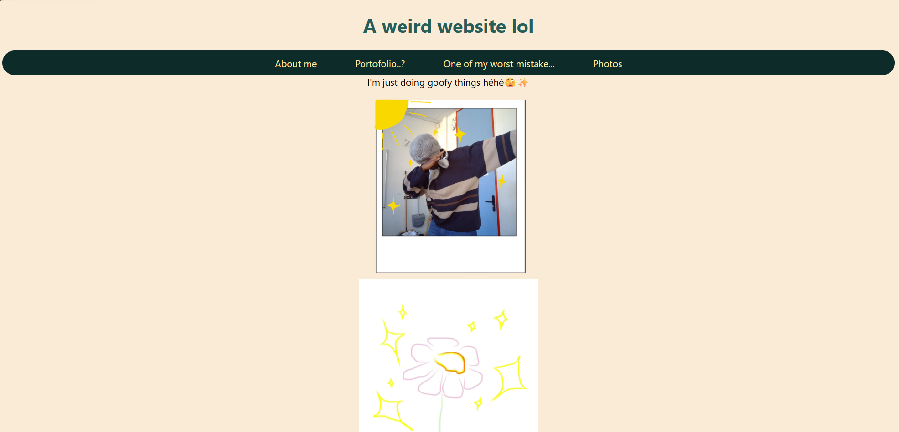
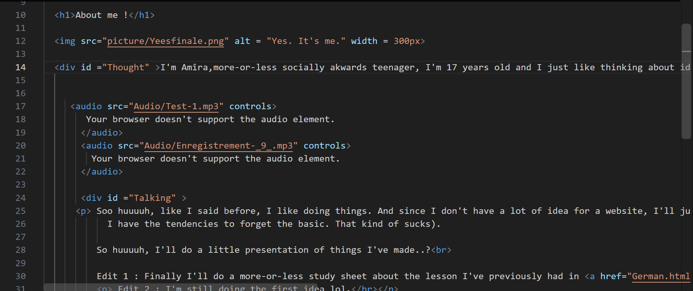

# A weird website

A weird website is a project I'v emade fir Expedition Ireland, a Hack Club program ! The purpose behind this website was to get familiar again with HTML ( and CSS. BUt mostly HTML :p). SO I've just wrote about myself and things that was going in my head, tht's why I said it was a bit chaotic lol.

# What does it do ?

Not a lot of things hehehe, you can navigate through the website adn learn about me *sparkle*.

There's 5 page on it. Maybe I'll add more later.

##### The first page of the website.

##### And a screenshot of the code.

# What did I use ?

Hmmmm, I used :

- **Visual Studio Code** : it's an app where I've code the website ( with HTML and CSS).
- **Ibis Paint** : I've made the little animation using the animation feature on it.

# Dependencies

You don't really need a lot of thing to run this project on your device :

A **browser** (Chrome, Edge, Firefox, Edge, etc).Personally, I use Edge.
You don't need a specific **OS**, it's shoukd work on any of it. ( but if you want to know, I'm on a *Windows 11*).
And if you want to modify the code, use an *IDE* like Visual Code Studio.

# Installation

You can download or clone this repository.
Then check that the folder is on your computer !
Find the 'index.html' and double click it.
Select a browser.
*Et voilà !*

**Edit for the reviewer, I've already passed 13,25 hours on it, the additional hour are the update :P**

### I've made this readme by following the templte of Fynr1x : https://gist.github.com/FaizeenHoque/0709576cc598721df07fb62d2430e6fe